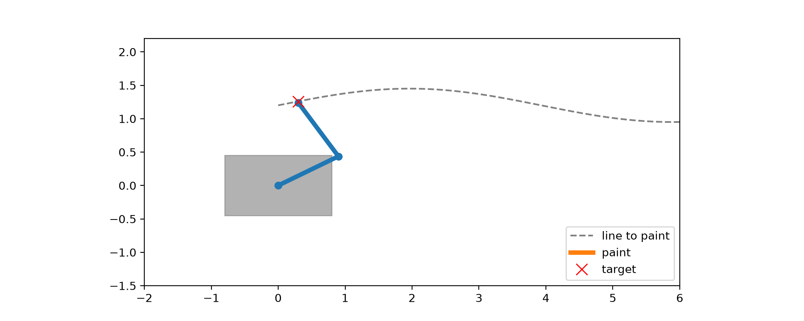

   # A robot arm that keeps painting straight while the truck wobbles

A truck drives along a curved line. The ground is rough, so the truck sways
sideways by up to 8 cm. A two-joint arm on the side of the truck has to keep
its nozzle exactly on the line anyway.

**Result in simulation: the nozzle stays within 2.1 cm of the line, 0.6 cm on average.**

This project builds the idea from scratch in plain Python, in three steps.

## How it works

**1. Forward kinematics: angles in, hand position out**

Each link is an arrow, and the hand is where the two arrows end up:

    x = L1*cos(θ1) + L2*cos(θ1 + θ2)
    y = L1*sin(θ1) + L2*sin(θ1 + θ2)

**2. Inverse kinematics: target in, angles out**

The harder direction, and the one a robot actually needs. The distance to the
target decides how much the elbow must bend (law of cosines). There are
usually **two solutions** (elbow bent one way or the other), and on a real arm
the floor can rule one of them out.

**3. Iterative inverse kinematics: let the arm walk to the target**

For arms with more joints, there is no neat formula. So the arm repeats a tiny
loop: measure how far the hand is from the target, work out how each joint
affects the hand (the Jacobian), and nudge the joints to shrink the error.

**4. Put it together**

Every frame, the arm takes the next point on the line and runs a few iterative
steps, starting from its previous pose (a warm start). That keeps the motion
smooth and absorbs the truck's wobble.

## Run it

    pip install matplotlib pillow
    python arm.py            # plots for steps 1 to 3
    python follow_line.py    # the truck simulation, writes demo.gif

## What I learned

- A target usually has two joint solutions, and the environment decides which is usable.
- The iterative method works for any arm, but it lands in whichever solution is
  nearest to where it started.
- Speed matters: if the arm cannot update fast enough, accuracy drops.

## Limits

This is a simplified model: a flat 2D arm, perfect knowledge of where the
target is, no sensor noise and no motor limits. A real system would need
sensing, filtering and a safety layer on top.

## Files

 - `arm.py`: forward, inverse and iterative kinematics with plots
 - `follow_line.py`: the moving-truck simulation, writes `demo.gif`